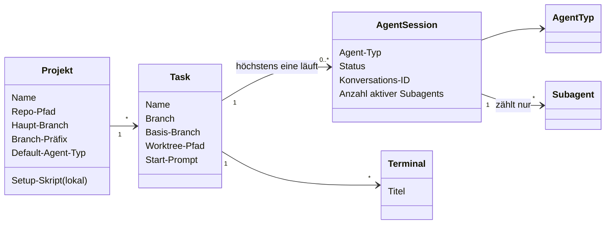
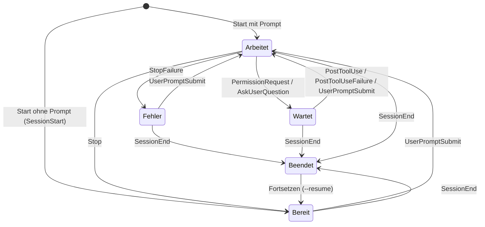
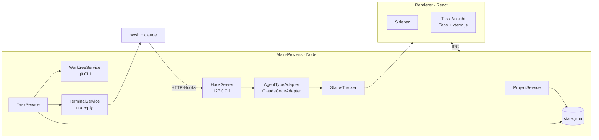

# Argus – Konzept

> **Zielbild**
> Eine Windows-Desktop-App, mit der ich **mehrere Coding-Agents parallel** über **mehrere Repositories** hinweg starte und beobachte. Jede Aufgabe läuft isoliert in einem eigenen **Git-Worktree**. Ich sehe auf einen Blick, welche Agent-Session **arbeitet**, welche **auf mich wartet** und welche **bereit** ist. Primär ein persönliches Tool, das später auch Kollegen nutzen können.

> **Name**
> **Argus** steht für **A**gent **R**un **G**overnance & **U**nified **S**upervision. In der griechischen Mythologie ist *Argus Panoptes* der Riese mit hundert Augen, der nie alle gleichzeitig schließt. Genauso behält das Tool alle Agent-Sessions im Blick. Repo: `argus`.

Inspiriert von der Analyse von Orca, aber bewusst deutlich schlanker:
- [Orca](https://github.com/stablyai/orca) (MIT): Tech-Stack, Status-Erkennung über Claude-Code-Hooks, Worktree-Lifecycle. Die ausführlichen Analyse-Notizen liegen außerhalb dieses Repos.

Begriffe: [Glossar](../GLOSSARY.md) · Entscheidungen: [docs/adr](adr/)

## 1. Rahmenbedingungen

| Thema | Entscheidung | Quelle |
|---|---|---|
| Nutzer | Primär ich, später an Kollegen verteilbar (Installer, keine hartkodierten Pfade) | – |
| Plattform | Electron-Desktop-App | [ADR 0001](adr/0001-electron-als-plattform.md) |
| Betriebssystem | Zunächst nur Windows; jedes Terminal ist eine PowerShell | [ADR 0002](adr/0002-zunaechst-nur-windows.md) |
| Agent-Typen | Claude Code im MVP, Codex muss später ohne Umbau ergänzbar sein | – |
| Interaktion | Echtes Terminal (PTY), keine eigene Chat-Oberfläche | – |
| Status-Erkennung | Claude-Hooks per `--settings` als HTTP-Hooks, globale Settings bleiben unberührt | [ADR 0003](adr/0003-hooks-per-settings-flag-und-http.md) |
| Orchestrierung | Nur ich starte Agent-Sessions; Subagents der Agents sind erlaubt | – |
| Lebensdauer | Terminals enden mit der App, Agent-Sessions sind per `--resume` fortsetzbar | [ADR 0004](adr/0004-kein-hintergrunddienst-fuer-terminals.md) |
| Git-Abschluss | Argus macht kein Commit, Push oder PR; das erledigt die Agent-Session oder ich | – |

## 2. Domänenmodell



**Kernregeln**
- Ein **Task** hat genau **einen Worktree** und **einen Branch**. Er gehört zu genau einem **Projekt**.
- In einem Task läuft **höchstens eine Agent-Session** gleichzeitig. Daneben gibt es beliebig viele **Terminals**.
- Eine **Agent-Session** ist eine *Konversation*, kein Prozess. `--resume` setzt *dieselbe* Agent-Session fort.
- Den **Agent-Typ** wähle ich pro Agent-Session. Default ist der Agent-Typ des Projekts.
- **Subagents** startet die Agent-Session selbst. Argus zählt sie nur.
- Projekte gruppieren Tasks in der Sidebar nur *virtuell*, sie haben keinen eigenen Zustand.

## 3. Statusmodell einer Agent-Session



| Status | Bedeutung | Darstellung |
|---|---|---|
| **Arbeitet** | mitten in einem Turn | blau, animiert |
| **Wartet** | braucht mich: Freigabe oder Rückfrage | orange + Toast |
| **Bereit** | Turn abgeschlossen, Ergebnis prüfbar | grün + Toast |
| **Fehler** | Turn durch Fehler abgebrochen | rot + Toast |
| **Beendet** | Prozess läuft nicht mehr, fortsetzbar | grau |

### Regeln für die Auswertung (Lehren aus Orca)

1. **Subagents verfälschen den Status nicht.** Events mit `agent_id` (also von Subagents) ändern den Status der Agent-Session nicht. `SubagentStart` und `SubagentStop` erhöhen bzw. senken nur den Zähler. Das Ende eines Subagents setzt die Agent-Session nie auf **Bereit**.
2. **„Wartet“ ist sticky.** Ein `PreToolUse` eines anderen Tools oder Subagents hebt **Wartet** nicht auf. Erst `PostToolUse`/`PostToolUseFailure` des Haupt-Agents, ein neuer Prompt oder `Stop` lösen es auf.
3. **`AskUserQuestion`** kommt als `PreToolUse` an, bedeutet aber **Wartet**.
4. **Abbruch durch mich** (Escape): Laut Claude-Doku feuert dann *kein* `Stop`. Der Status bleibt also auf **Arbeitet** hängen. → Siehe [Abschnitt 9](#9-im-prototyp-zu-prüfen).
5. **Beendet** wird über `SessionEnd` erkannt. Das PTY selbst endet nicht, weil die PowerShell mit `-NoExit` weiterläuft.

## 4. Architektur



### Tech-Stack

Wie Orca, auf das Nötige reduziert:

| Bereich | Technologie |
|---|---|
| Shell/Build | Electron + `electron-vite`, `electron-builder` (später Installer) |
| Sprache | TypeScript (strict) |
| UI | React, Tailwind CSS, shadcn/ui, lucide-react |
| State (UI) | Zustand |
| Terminal | xterm.js (Renderer) + node-pty mit ConPTY (Main) |
| Validierung | zod für IPC-Nachrichten und Hook-Payloads |
| Persistenz | JSON-Datei unter `%APPDATA%\Argus\state.json` |
| Tests | Vitest |

### Module im Main-Prozess

| Modul | Verantwortung |
|---|---|
| `ProjectService` | Projekte registrieren, Einstellungen pro Projekt |
| `TaskService` | Tasks anlegen und entfernen, koordiniert Worktree und Terminals |
| `WorktreeService` | `git worktree add/remove`, Branch löschen, Prüfung „geändert/ungepusht“ |
| `TerminalService` | PTYs erzeugen, Ein- und Ausgabe zum Renderer streamen, beenden |
| `HookServer` | HTTP auf `127.0.0.1:<port>`, prüft das Token, nimmt Hook-Events an |
| `AgentTypeAdapter` | **Schnittstelle pro Agent-Typ**: Startbefehl, Resume-Befehl, Hook-Konfiguration, Event → Status |
| `StatusTracker` | hält den Status pro Agent-Session, wendet die Regeln aus Abschnitt 3 an, löst Notifications aus |
| `Store` | atomares Lesen und Schreiben von `state.json` |

### Agent-Typ-Schnittstelle (Skizze)

Die Schnittstelle, über die Codex später andockt:

```ts
/** Everything the Argus needs to know about one agent CLI. */
interface AgentTypeAdapter {
  /** Stable identifier, e.g. "claude-code" or "codex". */
  readonly id: string;
  /** Builds the shell command that starts a new agent session. */
  buildStartCommand(context: AgentLaunchContext): string;
  /** Builds the shell command that resumes an existing conversation. */
  buildResumeCommand(context: AgentLaunchContext, conversationId: string): string;
  /** Translates a raw hook payload into a status event, or null if irrelevant. */
  interpretHookEvent(payload: unknown): AgentStatusEvent | null;
}
```

## 5. Abläufe

### 5.1 Projekt hinzufügen

1. Repo-Ordner auswählen → prüfen, ob es ein Git-Repo ist
2. Haupt-Branch ermitteln (`origin/HEAD`), Branch-Präfix (Default `agent/`) und Default-Agent-Typ festlegen
3. Optional ein lokales **Setup-Skript** (PowerShell) hinterlegen, z. B. `.env` kopieren oder `dotnet restore`

### 5.2 Task anlegen

**Eingaben:** Projekt, Task-Name, Basis-Branch (Default: Haupt-Branch), optional Start-Prompt und Agent-Typ.

1. Name bereinigen und eindeutig machen → `<WorktreeRoot>\<Projekt>\<task-name>`
   - Der WorktreeRoot ist global einstellbar, z. B. `D:\Worktrees`
   - Namen gelöschter Tasks werden **nicht wiederverwendet**: Claude speichert Konversationen pro Pfad
2. `git fetch` für den Basis-Branch, dann:
   `git worktree add --no-track -b <präfix>/<task-name> <pfad> <basis>`
3. `git config push.autoSetupRemote true` im Worktree, Basis-Branch im Task speichern
4. Ist ein Setup-Skript vorhanden: Es läuft **sichtbar** im ersten Terminal, mit `ARGUS_ROOT_PATH` (Haupt-Repo) und `ARGUS_WORKTREE_PATH` (Worktree) in der Umgebung. Die Agent-Session startet erst, wenn das Setup beendet ist.
   - Endet das Setup mit Fehler (Exit-Code ≠ 0), kommt die Rückfrage **„Setup fehlgeschlagen. Agent-Session trotzdem starten?“**. Die Ausgabe des Setups bleibt im Terminal sichtbar.
5. Agent-Session starten (siehe 5.3)

### 5.3 Agent-Session starten bzw. fortsetzen

1. Eine Agent-Session-ID erzeugen. Hook-Settings-Datei schreiben: `%APPDATA%\Argus\hooks\claude-code.json` (eine Datei für alle, die Werte kommen aus Umgebungsvariablen).
2. PTY starten: `pwsh -NoExit` (Fallback `powershell.exe`), `cwd` = Worktree. Umgebungsvariablen setzen:
   - `ARGUS_PORT`
   - `ARGUS_TOKEN`
   - `ARGUS_SESSION_ID`
3. Befehl: `claude --settings <hook-datei> ["<start-prompt>"]`
   - Fortsetzen: `claude --settings <hook-datei> --resume <konversations-id>`
   - Den Start-Prompt per `-EncodedCommand` oder eine Prompt-Datei übergeben, um Probleme mit PowerShell-Quoting zu vermeiden
4. Das erste Hook-Event liefert die `session_id` von Claude. Sie wird als **Konversations-ID** gespeichert und für `--resume` gebraucht.

Hook-Settings (Skizze):

```json
{
  "hooks": {
    "Stop": [{ "hooks": [{
      "type": "http",
      "url": "http://127.0.0.1:${ARGUS_PORT}/hooks/claude-code",
      "timeout": 2,
      "headers": {
        "X-Argus-Token": "$ARGUS_TOKEN",
        "X-Argus-Session": "$ARGUS_SESSION_ID"
      },
      "allowedEnvVars": ["ARGUS_TOKEN", "ARGUS_SESSION_ID", "ARGUS_PORT"]
    }]}]
  }
}
```

Dieselbe Konfiguration gilt für: `SessionStart`, `UserPromptSubmit`, `PreToolUse`, `PostToolUse`, `PostToolUseFailure`, `PermissionRequest`, `Stop`, `StopFailure`, `SubagentStart`, `SubagentStop`, `SessionEnd`.

> [!WARNING]
> **Zu prüfen**
> Ob Umgebungsvariablen auch in der `url` aufgelöst werden, ist offen. Falls nicht: einen festen Port verwenden oder die Datei pro App-Start mit dem konkreten Port neu schreiben.

### 5.4 Arbeiten am Task

- Ein Klick auf einen Task öffnet die Task-Ansicht. Tab 1 ist die Agent-Session, die weiteren Tabs sind Terminals (`+` für ein neues).
- Ein Klick auf einen Task mit Status **Wartet** springt direkt in den Tab der Agent-Session.
- Freigaben und Rückfragen beantworte ich **im Terminal**, nicht über die Oberfläche.
- Commit, Push und PR erledigt die Agent-Session per Prompt (`git`, `gh` bzw. `az`) oder ich selbst im Git-Tool.
- Review findet außerhalb statt (Git-Tool bzw. PR). Argus bietet „Im Editor öffnen“ und „Im Explorer öffnen“.

### 5.5 Task entfernen

1. Prüfen, ob die Agent-Session **arbeitet** → Warnung
2. Alle PTYs des Tasks beenden und das Ende abwarten (Windows hält sonst Dateien fest)
3. Prüfen: uncommittete Änderungen? ungepushte Commits? → in der Bestätigung anzeigen
4. `git worktree remove <pfad>`
5. `git branch -d <branch>`
   - Schlägt das fehl (z. B. nach einem Squash-Merge des PRs): Rückfrage **„Branch ist nicht gemerged. Trotzdem löschen?“**. Hinweis „ist vollständig gepusht“ bzw. **ungepushte Commits rot markiert**. Erst nach Bestätigung `git branch -D`.
6. Task aus `state.json` entfernen, Task-Namen als „verbraucht“ merken

### 5.6 App schließen und starten

- **Schließen:** Wenn Agent-Sessions **arbeiten**, gibt es eine Warnung. Danach werden alle PTYs beendet.
- **Starten:** Projekte und Tasks werden aus `state.json` geladen. Alle Agent-Sessions stehen auf **Beendet** und lassen sich per Button **Fortsetzen** wiederaufnehmen. Worktrees, die es nicht mehr gibt, werden markiert.

## 6. Oberfläche

```
┌─────────────────────────┬──────────────────────────────────────────────────┐
│ Argus              [+]  │ login-refactoring          agent/login-refactoring│
│                         │ D:\Worktrees\webshop\login-refactoring            │
│ ▾ WEBSHOP               │ [Im Editor] [Explorer] [Fortsetzen] [Entfernen]   │
│   ● login-refactoring   │──────────────────────────────────────────────────│
│     Wartet · 2 Sub · 5Δ │ [● Claude Code] [Terminal 1] [+]                  │
│   ● pdf-export          │                                                   │
│     Arbeitet · 3Δ       │  > claude                                         │
│ ▾ HomeServer            │  Claude möchte `dotnet test` ausführen.           │
│   ● api-caching         │  1. Ja  2. Ja, immer  3. Nein                     │
│     Bereit · 12Δ        │                                                   │
│   ○ readme-update       │                                                   │
│     Beendet             │                                                   │
└─────────────────────────┴──────────────────────────────────────────────────┘
  ● Farbe = Status · „2 Sub“ = aktive Subagents · „5Δ“ = geänderte Dateien
```

**Notifications:** Ein Windows-Toast bei **Wartet**, **Bereit** und **Fehler**, aber nur wenn das Fenster nicht im Fokus ist. Ein Klick auf den Toast öffnet den Task.

## 7. MVP-Umfang

**Drin**
- [ ] Projekte hinzufügen und entfernen, Einstellungen pro Projekt (Präfix, Default-Agent-Typ, Setup-Skript)
- [ ] Task anlegen (Worktree + Branch), Setup-Skript ausführen
- [ ] Agent-Session mit Claude Code starten, optional mit Start-Prompt
- [ ] Status per HTTP-Hooks, Statusregeln inklusive Subagent-Zähler
- [ ] Sidebar mit Status, Subagent-Zähler und Anzahl geänderter Dateien
- [ ] Task-Ansicht mit Tabs (Agent-Session + Terminals)
- [ ] Toast-Notifications
- [ ] Task entfernen mit sicherer Branch-Löschung
- [ ] Persistenz und „Fortsetzen“ per `--resume`
- [ ] Buttons „Im Editor öffnen“ und „Im Explorer öffnen“

**Bewusst nicht drin**
- Diff- bzw. Review-Ansicht, Zeilen-Kommentare
- Git-Aktionen in der Oberfläche (Commit, Push, PR, Merge)
- Freigaben über die Oberfläche beantworten
- Split-Panes, frei anordenbare Layouts
- Hintergrunddienst für Terminals
- Remote, SSH, WSL, Mobile, macOS, Linux
- automatisches Cleanup, Sparse Checkout, vorbereitete Worktrees

## 8. Später (Backlog)

1. **Codex** als zweiter Agent-Typ (Hooks bzw. Status-Erkennung von Codex klären)
2. **Diff-Ansicht** pro Task (Monaco DiffEditor)
3. **Setup-Datei im Repo** (`.argus.yaml`) mit Trust per Hash, für Kollegen
4. **Installer und Auto-Update** (`electron-builder`, `electron-updater`) zur Verteilung an Kollegen
5. Tray-Icon mit Zähler „wartet auf dich“
6. Button „Pushen und PR erstellen“ (GitHub bzw. Azure DevOps)
7. Freigaben direkt aus der Oberfläche beantworten (`PermissionRequest` offen halten)
8. Feedback-Schleife: Zeilen-Kommentare als Prompt an die Agent-Session
9. Fallback-Status-Erkennung über den Terminal-Titel bzw. OSC 7501

## 9. Im Prototyp zu prüfen

Bevor die eigentliche Umsetzung beginnt, prüft ein kleiner Spike (Electron + node-pty + Hook-Server):

- [ ] Laufen Hooks aus `--settings` **zusätzlich** zu den Hooks in `~/.claude/settings.json`?
- [ ] Verhalten bei nicht erreichbarer Hook-URL: Bleibt Claude flüssig, wie groß ist die Verzögerung?
- [ ] Werden `$VAR` in `url` und `headers` aufgelöst (`allowedEnvVars`)?
- [ ] Ist bei Hook-Events von Subagents `agent_id` gesetzt, sodass sie sich vom Haupt-Agent unterscheiden lassen?
- [ ] Welches Event kommt beim Abbruch per Escape? (Laut Doku kein `Stop`.) Falls keins: Fallback über den Terminal-Titel oder Ausgabe-Inaktivität.
- [ ] Kommt `SessionEnd` zuverlässig, auch bei `/exit` und Strg+C?
- [ ] node-pty mit ConPTY in Electron unter Windows: Rendering, Resize, Umlaute
- [ ] Start-Prompt mit Sonderzeichen sicher übergeben (`-EncodedCommand`)

> [!TIP]
> **Fallback**
> Scheitern die HTTP-Hooks per `--settings`, greift die Orca-Variante: ein globales Hook-Skript mit einem Guard auf `ARGUS_SESSION_ID`, das per `curl.exe` postet (siehe [ADR 0003](adr/0003-hooks-per-settings-flag-und-http.md)).

## 10. Umsetzung

- **Eigenes Git-Repository** (Name: **Argus**, Repo `argus`)
- Repo: https://github.com/viper1979/argus
- **Glossar und ADRs leben ab jetzt im Repo** (`GLOSSARY.md`, `docs/adr/`). Sie sind die maßgebliche Quelle.
- Es gelten die allgemeinen Coding-Guidelines: Code auf Englisch, Doc-Comments, Unit-Tests (AAA-Muster) für Geschäftslogik. Zuerst testen: Statusregeln (`StatusTracker`, `interpretHookEvent`), Pfad- und Namensbildung, Branch-Lösch-Entscheidung.
- Reihenfolge: **Spike (Abschnitt 9) → Grundgerüst Electron → Projekte und Tasks → Terminals → Hooks und Status → Entfernen → Persistenz und Fortsetzen**
